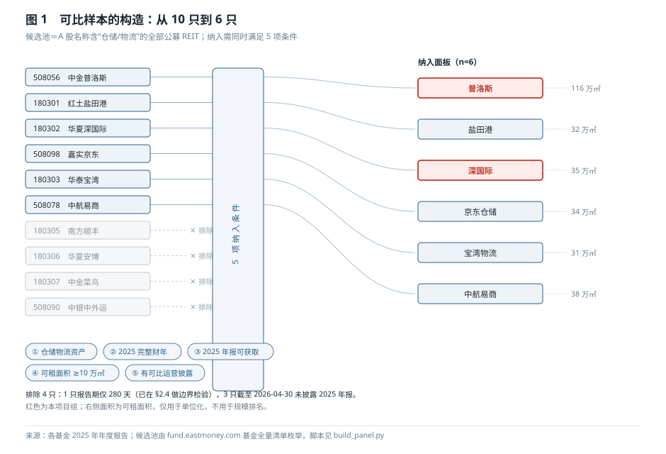
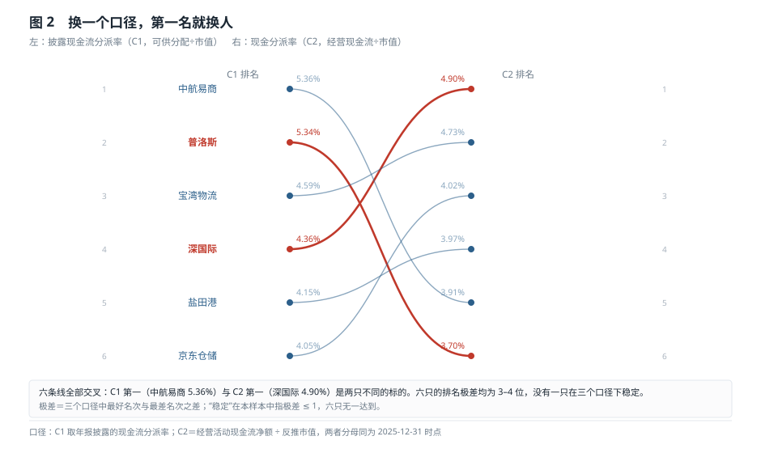
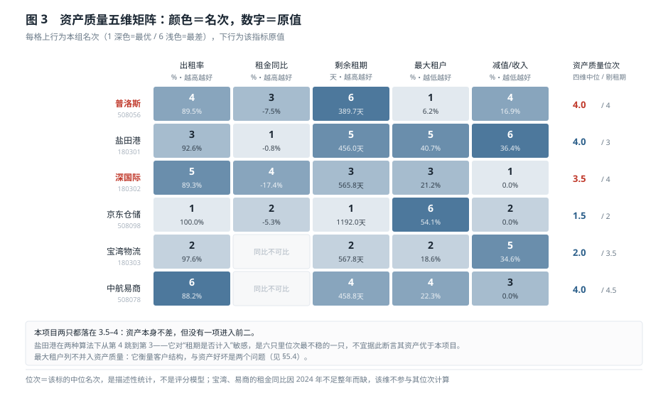
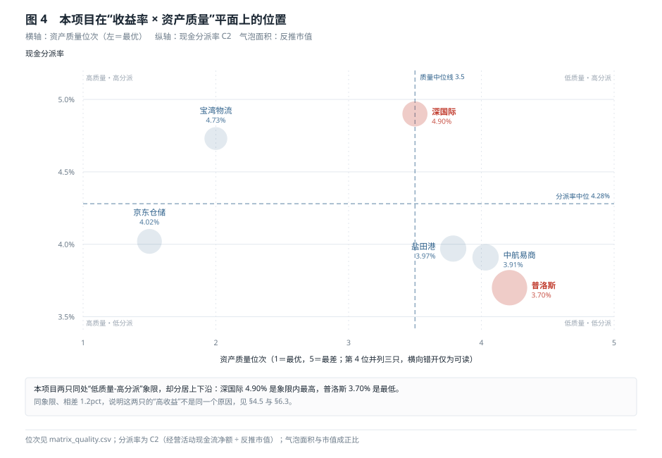
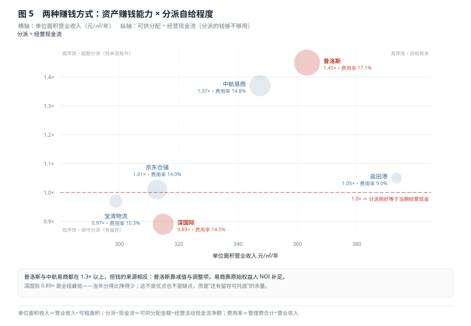

# 仓储物流公募 REITs 横向基准报告（2025 年度）

| 项 | 内容 |
|---|---|
| 报告类型 | 横向基准（peer benchmarking）：同一时点、同类资产的相对定位与商业模式比较 |
| 本项目 | 中金普洛斯仓储物流 REIT（508056）＋ 华夏深国际仓储物流 REIT（180302） |
| 对标范围 | 6 只仓储物流公募 REIT（含本项目 2 只），从 10 只候选池中筛选 |
| 比较时点 | 2025-12-31 时点指标 ＋ 2025 年 1—12 月期间指标 |
| 资料截止日 | 2026-04-30（六份 2025 年年度报告全部为直接抽取的一手 PDF） |
| 数据版本 | `build_panel.py`（输出 `panel_2025.csv` / `matrix_yield.csv` / `matrix_quality.csv` / `sample_funnel.csv`） |
| 图表版本 | `make_figs.py`（5 张图，坐标由数据计算得出） |
| 执行依据 | `skills/reits-peer-benchmarking` 的 FLOW `#1`—`#20`（逐步映射见附录 A.5） |
| 报告版本 | v1.0 |
| 中文正文字符数 | 15,295（§1–§9 正文；全文含附录 16,877） |
| 图表 | 图 5 张（HTML 版内联为 SVG，Markdown 版引用 `figures/`）／表 28 张 |
| 统计口径 | 仅计正文中文字符，不含封面、附录、来源索引 |

---

## 1 结论：本项目在市场中的位置

### 1.1 三句话

**第一，收益率上本项目一只排第二、一只排第四，但这两个名次都不可靠。** 普洛斯的披露分派率 5.34% 在六只里第 2，深国际 4.36% 第 4；换成「经营现金流÷市值」这个口径，普洛斯掉到第 6（3.70%）、深国际升到第 1（4.90%）。**同一时点、同一批资产，排名可以整体翻转。**

**第二，资产质量上两只都在中游偏下（并列第 4 与第 3.5），没有一项进入前二。** 出租率、租金趋势、租约久期、减值四项的中位名次，普洛斯 4.0、深国际 3.5，六只里只优于盐田港与中航易商。**它们的「高收益」不是靠资产质量换来的。**

**第三，真正稀缺的是客户结构，而这一点两只恰好是两个极端。** 普洛斯约 80 户、最大租户 6.21%、前五 25.26%，是六只里唯一被年报正面证实「无单一客户超 10%」的标的；深国际 42 户看似分散，但年报 §4.4.2 披露同一跨国集团两家子公司合计 36.75%、关联方深圳全程 18.47%，**实际 55.22% 的现金流来自「同一集团或自家集团」**。**同一句「仓储物流 REIT」，商业模式可以完全相反。**

### 1.2 位置一览

| 维度 | 普洛斯（508056） | 深国际（180302） | 组内位置 | 判断依据 |
|---|---|---|---|---|
| 披露分派率 C1 | 5.34% | 4.36% | 第 2 / 第 4 | §4.2 |
| 现金分派率 C2 | 3.70% | 4.90% | 第 6 / 第 1 | §4.3 |
| 单位面积经营现金流 C3 | 199 元/㎡ | 236 元/㎡ | 第 5 / 第 3 | §4.4 |
| 三口径排名极差 | 4 位 | 3 位 | 与其余四只同在 3—4 位 | §4.5 |
| 资产质量位次 | 4.0 | 3.5 | 中游偏下 | §5.6 |
| 客户结构 | 真分散（最大 6.21%） | 同集团 36.75% ＋ 关联 18.47% | 两个极端 | §5.4 |
| 商业模式 | 多资产·多租户·高费用率 | 双资产·锚租户·强绑定 | 互为反面 | §7.4 |
| 单位面积市值 | 5,396 元/㎡ | 4,816 元/㎡ | 第 3 / 第 5 | §6.4 |

### 1.3 这份报告能回答什么

它回答三个问题：**同一时点上，本项目在收益率和资产质量两个维度各处于什么位置；这个位置在不同口径下是否稳定；六只标的的赚钱方式有什么结构性差异，本项目两只各自的可改进处与独特优势在哪里。**

它不能回答的也写清楚：**不能给出「哪只更值得买」。** 六个样本、单一资产类型、单一年度，任何「最优」结论都会被下一期数据改写。**不给总分、不给评级、不给目标价**——这不是保守，而是 n=6 的样本量撑不起这些结论。本报告给的是**条件式判断**：在什么口径下谁更好、这个结论有多稳、如果条件变化会改哪一句。

---

## 2 为什么是这六只：可比样本的构造

### 2.1 「类似 ABS 或 REITs」在本报告中的三层收敛

委托要求的原话是「与其他类似 ABS 或 REITs 项目比较」。这句话不能直接执行，因为「类似」和「ABS 或 REITs」两个词都存在歧义。本报告做了三层收敛，**每一层都在报告里写明，读者可以不同意，但能看见我怎么选的**。

**第一层：把「ABS 或 REITs」收敛为公募基础设施 REITs。** 中国的公募 REITs 交易结构本身就是「公募基金 → 资产支持专项计划 → 项目公司 → 底层物业」，**它在法律形态上就是 ABS 的公开市场版本**。因此「类似 ABS 或 REITs」在境内语境下指向的是同一类产品，不存在「REITs 之外还有一批可比的 ABS」这种情况。

**第二层：把「类似」收敛为同一底层资产类型。** 仓储物流与产业园、数据中心、消费基础设施在租约结构、定价机制、资本开支节奏上差异极大：产业园靠政策与产业链，数据中心靠电力与算力客户，消费基础设施靠客流。**跨资产类型做「分派率排名」是可以的，但做「资产质量排名」没有意义**——出租率对仓储是核心指标，对高速公路毫无意义。因此本报告的样本边界锁定在**高标准物流仓储（含保税仓）**。

**第三层：把「可比」收敛为可执行的五项条件。** 落到操作层，一条标的要进入面板必须同时满足：① 底层资产为仓储物流；② 报告期为 2025 年完整财年；③ 2025 年年度报告可获取；④ 期末可租面积不低于 10 万㎡；⑤ 年报中同时披露可供分配金额与运营指标。**五条中任何一条不满足，就排除，并写下排除理由与影响。**

三层收敛之后，被排除的范围是明确的：**类 REITs/CMBS 等非公开产品不纳入**，原因是它们没有公开估值、没有季度运营披露、没有可比的市值口径——把它们放进同一张表，得到的「便宜」只是流动性折价，不是基本面差异。

图 1　可比样本的构造：从 10 只到 6 只

### 2.2 候选池是全量枚举，不是随手挑的

候选池不是凭印象列的。做法是取基金全量清单（`fund.eastmoney.com/js/fundcode_search.js`，约 2 万条），按名称含「仓储」或「物流」筛出全部公募 REIT，得到 **10 只**：

| 代码 | 简称 | 成立/上市 | 结论 | 理由 |
|---|---|---|---|---|
| 508056 | 中金普洛斯 | 2021-06-21 | 纳入 | 五项条件全部满足 |
| 180301 | 红土盐田港 | 2021-06-21 | 纳入 | 同上 |
| 180302 | 华夏深国际 | 2024-06-25 | 纳入 | 同上（2025 为其首个完整财年） |
| 508098 | 嘉实京东 | 2023-01-11 | 纳入 | 同上 |
| 180303 | 华泰宝湾 | 2024-09-13 | 纳入 | 同上 |
| 508078 | 中航易商 | 2024-12-24 | 纳入 | 同上 |
| 180305 | 南方顺丰 | 2025-03-27 | 排除 | 报告期仅 280 天，同比与周转类指标失真 |
| 180306 | 华夏安博 | — | 排除 | 截至 2026-04-30 未披露 2025 年报 |
| 180307 | 中金菜鸟 | — | 排除 | 同上 |
| 508090 | 中银中外运 | — | 排除 | 同上 |

**这一步的意义在于：「全样本」这句话必须有清单支撑。** 如果只凭印象列出四只就宣布「仓储物流 REIT 全样本」，那么这个「全」字是假的——而基于假全样本得出的「本项目分派率第一」，也就只是在四个样本里的第一。

### 2.3 每一条排除理由都要能承受追问

**排除理由分三级，混写会让读者误判哪些缺口值得追**：期间不完整（等一年可解）、披露不可得（需换渠道或等下一期）、类型不同质（永远不可比）。本样本落在前两级；第三级已在 §2.1 处理——类 REITs／CMBS 等非公开产品在候选池阶段就不进池，因为它们没有公开估值、季度运营披露与可比市值口径。

**南方顺丰（180305）：期间不完整。** 2025-03-27 成立，报告期 280 天。它有 2025 年报，但期间不完整。**排除它不是因为数据差，而是因为「期间」这个口径无法与其余六只对齐**——把 280 天的可供分配直接与 365 天并列，会系统性低估它；自己年化又会引入假设。所以排除，但做边界检验（见 §2.4）。

**华夏安博（180306）、中金菜鸟（180307）、中银中外运（508090）：披露不可得。** 截至 2026-04-30 均未披露 2025 年年度报告。这是**披露时点差异**，不是数据质量问题。**这三只不是「不重要」，而是「这一期拿不到」。** 报告在附录把这三只登记为「披露缺失」，并在 §9 写明下一期纳入。**登记为「披露缺失」而非「不可比」，是因为它们在 2027 年 3 月就能进样本——下一期必须重算全部名次，不能沿用本期结论。**

**为什么把「可租面积 ≥10 万㎡」作为门槛**：不是为了筛掉小的，而是为了**保证单位化指标有意义**。六只的可租面积在 31 万—116 万㎡ 之间，最大与最小相差 3.7 倍。**当面积差超过 3 倍时，绝对额排名（谁的收入高、谁的现金流多）反映的是规模而不是质量**，必须一律换成「每㎡」。门槛设在 10 万㎡ 是这条规则的执行前提。

### 2.4 边界检验：如果硬把顺丰拉进来，会改哪一句

样本边界可以不破，但必须知道「破了会改哪一句」。对 180305 只取四个数——年化分派率、反推单位面积市值、可租面积、前五集中度——做了边界检验：

| 项目 | 顺丰 180305 | 若纳入后的位置 | 会改写的结论 |
|---|---|---|---|
| 年化披露分派率 | 约 4.04% | 低于京东 4.05%，成为 C1 末位 | **改写「C1 末位是京东」这一句** |
| 反推单位面积市值 | 约 5,538 元/㎡ | 落在易商 6,055 与普洛斯 5,396 之间 | 普洛斯「单位面积第 3 贵」变第 4 贵 |
| 可租面积 | 722,329 ㎡ | 第 2 位（仅次于普洛斯） | 「第二大规模」从 38 万㎡ 变 72 万㎡ |
| 期末出租率 | 95.91% | 第 3 位 | 不改写 |
| 前五集中度 | 约 75%（130 户，最大 22.40%） | 中位水平 | 不改写 |

**结论：纳入它不会推翻「三个口径三个第一名」，但会改写一处细节——C1 的末位。** 这正是样本边界的正确用法：**边界可以不破，但必须知道「破了会改哪一句」。** 反过来说，如果一条边界怎么动都改不了任何结论，那说明样本已经足够。

### 2.5 n=6 的三条自我约束

**第一，不做分位表述。** 不说「处于 33 分位」「优于行业中位数」——六个样本算不出有意义的分位数。本报告只说「第几名」，且每次都说清是几个样本里的第几名。

**第二，不做显著性检验。** 六个点算相关系数可以做（§6.4），但不能给 p 值、不能说「显著」。**相关系数在这里是描述工具，不是推断工具。**

**第三，位次是描述性统计，不是评分模型。** §5.6 的「资产质量位次」是四个维度名次的中位数，等权、无权重调整。它适合回答「谁在这一组里相对靠前」，**不适合回答「谁的资产值多少钱」**。

---

## 3 同一时点：时点与口径如何对齐

### 3.1 「同一时点」的两个含义

「同一时间点比较」在实际操作中会分裂成两个问题，必须分开处理：

**时点指标**（出租率、租金单价、剩余租期、租户集中度、单位面积市值）取 **2025-12-31**。这一类指标的陷阱是「期末时点」与「期间平均」混用——出租率用期末值，租金用期末单价，两者都不是全年平均。**本报告一律取期末值，并在表头标注「时点」。**

**期间指标**（营业收入、经营现金流、可供分配、减值）取 **2025 年 1—12 月**。这一类指标的陷阱是「报告期长度」不一致——六只中有三只 2024 年才成立，但 2025 年都是完整 12 个月，**所以期间指标可比，同比指标不全可比**。

**这条区分直接决定了一个限制：租金同比只有四只有值。** 宝湾（2024-09-13 成立）与中航易商（2024-12-24 成立）的 2024 年基期不足整年，同比不可计算。**因此 §5.2 的「量价四象限」只覆盖四只，这一点必须在结论里显式说明，否则会被读成「六只都在跌」。**

### 3.2 分母才是分派率的真问题

「现金流分派率」= 可供分配金额 ÷ 分母。**分母取什么，直接决定排名。** 市场上同时存在三种分母：

- **募集规模**：发行时的定价，用于计算「发行时的分派率」，是静态的；
- **评估值**：资产评估机构给的物业价值，与二级市场价格脱节；
- **市值**：二级市场交易价格，随时点变化。

**本报告统一用市值，且不用外部行情数据，而是用「可供分配金额 ÷ 年报披露的现金流分派率」反推。** 理由有三条：

**第一，时点一致。** 年报披露的分派率是基金自己算的、与其披露的可供分配金额严格对应。用外部行情取市值，会引入「行情日期」与「年报基准日」之间的错配——2025 年 12 月 31 日到年报披露日之间，价格可能已经变了 10%。

**第二，可复现。** 反推市值 = 3.352 亿 ÷ 5.34% = 62.77 亿，任何人拿年报都能算出来。用外部行情则依赖数据源与时点，别人复现不了。

**第三，可交叉校验。** 用 2024 年数据反推普洛斯市值 65.53 亿，2025 年 62.77 亿，全年 −4.21%，与仓库内既有投后报告记录的 −4.2% 一致。**两条独立路径得出同一个数，说明方法自洽。**

**为什么不用评估值做分母，还有一个更实际的理由：评估基准日不统一。** 六只基金的评估报告基准日分布在 2024-12-31 与 2025-06-30 两个时点，而年报披露的分派率是 2025 年全年口径。**用半年前的评估值去除全年的可供分配，分子与分母不在同一个时间维度上**——这会让评估值在 2025 年下半年上涨的标的显得「分派率高」，而这个「高」只是时间错配。相比之下，反推市值虽然也只是近似，但它的时点与分派率严格同源。

**这个选择也有代价，必须写明：反推市值只能用于「同一份年报内」的比较，不能用于跨期。** 因为分派率本身是年报口径，如果某一年基金调整了分派率的计算方式（例如分母从募集规模改为市值），反推市值就会失真。本报告在附录逐只登记了分派率的口径来源。

### 3.3 五处必须对齐的口径

跨标的比较最容易出错的地方不是算错，而是「两个都对，但不能放在一起」。本报告处理了五处：

| 陷阱 | 表现 | 处理方式 |
|---|---|---|
| 租金单位 | 有的披露「元/㎡/天」，有的披露「元/㎡/月」 | 统一换算为元/㎡/月：天 × 365 ÷ 12 |
| 租期单位 | 有的披露「年」，有的披露「天」 | 统一换算为天：年 × 365 |
| 分派率分母 | 募集规模 / 评估值 / 市值三种混用 | 统一为反推市值，见 §3.2 |
| EBITDA 是否含减值 | 披露的 EBITDA 桥通常不含资产减值 | **一律回加减值**，否则减值大的标的被系统性低估 |
| 可租面积口径 | 是否含配套用房、是否含在建 | 统一取「期末可供出租面积」，不用建筑面积 |

**其中第四条最容易被忽略，也最容易造成误判。** 盐田港 2025 年计提减值 4,561 万元（占营业收入 36.40%），宝湾计提 3,198 万元（34.58%），普洛斯 7,152 万元（16.93%）。**如果用未回加减值的 EBITDA 算 EBITDA 率，盐田港是 39.2%，回加后是 75.56%——两者相差近一倍。** 前者会让人得出「盐田港盈利能力最差」的结论，而真实情况是它的**现金盈利能力最强、账面减值最重**。

---

## 4 收益率：三个口径，三个第一名

### 4.1 为什么必须用三个口径

单看「分派率」，六只的差距只有 1.31 个百分点（5.36% 到 4.05%）。**在小差距上做排名，任何口径的微小差异都能改变结果。** 所以本报告用三个口径同时看：

- **C1 披露分派率** = 可供分配金额 ÷ 市值。基金自己披露的口径，反映「按基金的定义，今年能分多少」。
- **C2 现金分派率** = 经营活动现金流净额 ÷ 市值。**剔除了会计调整项**，反映「今年实际挣到多少现金」。
- **C3 单位面积经营现金流** = 经营活动现金流净额 ÷ 可租面积。**剔除了资本结构**，反映「每平方米资产一年能产出多少现金」。

三个口径分别回答三个问题：**基金说能分多少、实际挣了多少、资产本身能产出多少。** 三者不一致的地方，就是需要解释的地方。

### 4.2 C1：中航易商第一，但它的第一名有一半是「补」出来的

| 标的 | 可供分配（亿） | 反推市值（亿） | C1 | 名次 |
|---|---|---|---|---|
| 中航易商 | 1.241 | 23.16 | **5.36%** | 1 |
| 普洛斯 | 3.352 | 62.77 | 5.34% | 2 |
| 宝湾物流 | 0.550 | 11.98 | 4.59% | 3 |
| 深国际 | 0.744 | 17.06 | 4.36% | 4 |
| 盐田港 | 0.926 | 22.31 | 4.15% | 5 |
| 京东仓储 | 0.719 | 17.75 | 4.05% | 6 |

**中航易商的 5.36% 里，有 2,618 万元是 ESR（原始权益人）的 NOI 补足，占可供分配的 21.1%。** 这不是财务操纵——它是发行时写进招募说明书的承诺兑现。但它意味着：**这份分派的可持续性取决于 ESR 的履约意愿，而不是昆山花桥园区的现金流。**

更值得看的是补足的触发原因。2025 年该基金目标 NOI 1.40 亿元，实际 1.08 亿元，**缺口 23%**；按协议，基本服务费被全额扣减 645 万元（扣到零）。**「保底」保的是可分配现金，不是盈利能力**——园区实际赚的钱比承诺少了两成，差额由原始权益人补上。这个机制在承诺期内是保护，承诺期结束后如果没有新的安排，5.36% 会直接回落到 4.23%（见 §4.6）。

### 4.3 C2：深国际第一，因为它是唯一「分得比挣得少」的

| 标的 | 经营现金流（亿） | 反推市值（亿） | C2 | 名次 | C2 与 C1 的名次变化 |
|---|---|---|---|---|---|
| 深国际 | 0.837 | 17.06 | **4.90%** | 1 | 第 4 → 第 1（↑3） |
| 宝湾物流 | 0.567 | 11.98 | 4.73% | 2 | 第 3 → 第 2（↑1） |
| 京东仓储 | 0.713 | 17.75 | 4.02% | 3 | 第 6 → 第 3（↑3） |
| 盐田港 | 0.886 | 22.31 | 3.97% | 4 | 第 5 → 第 4（↑1） |
| 中航易商 | 0.906 | 23.16 | 3.91% | 5 | 第 1 → 第 5（↓4） |
| 普洛斯 | 2.320 | 62.77 | 3.70% | 6 | 第 2 → 第 6（↓4） |

**深国际从第 4 升到第 1，唯一原因是它的可供分配（0.744 亿）小于经营现金流（0.837 亿），倍数为 0.89。** 换句话说：**它当年挣了 0.837 亿现金，只分了 0.744 亿，留下了 0.093 亿。**

这是优点还是缺点，取决于问什么。**如果问「今年到手的现金回报」，它是第一；如果问「分派还有多少提升空间」，它还有留存；如果问「为什么留存」，答案是它 2025 年租金跌了 17.45%，需要留现金应对续租风险。** 同一个数字，三种解释，报告必须都写。

**普洛斯从第 2 掉到第 6，原因相反：它的可供分配（3.352 亿）远超经营现金流（2.320 亿），倍数 1.45。** 差额 1.03 亿从哪来？§4.6 拆解。

### 4.4 C3：盐田港第一，因为它每平方米最贵

| 标的 | 经营现金流（亿） | 可租面积（万㎡） | C3（元/㎡/年） | 名次 |
|---|---|---|---|---|
| 盐田港 | 0.886 | 31.9 | **278** | 1 |
| 中航易商 | 0.906 | 38.2 | 237 | 2 |
| 深国际 | 0.837 | 35.4 | 236 | 3 |
| 京东仓储 | 0.713 | 34.1 | 209 | 4 |
| 普洛斯 | 2.320 | 116.3 | 199 | 5 |
| 宝湾物流 | 0.567 | 31.0 | 183 | 6 |

**盐田港的单位面积现金流 278 元/㎡，比宝湾的 183 元/㎡ 高 52%。** 原因不是运营效率，而是**位置**：它位于深圳盐田保税区，期末租金 38.32 元/㎡/月，是六只里最高的（宝湾 27.54、京东 27.38）。**租金高 → 单位面积收入高 → 单位面积现金流高，这是同一件事的三层表达。**

**普洛斯在这一口径下掉到第 5，是三个口径里它最难看的位置。** 它的可租面积 116.3 万㎡ 是六只里最大（是第二名的 3.3 倍），但单位面积现金流只有 199 元，低于深国际（236）与易商（237）。**规模没有转化为单位效率**——原因见 §5.2 的量价分析：它的租金同比 −7.48%，出租率 89.54%，两项都在中下。

### 4.5 排名极差：没有一只稳

把三个口径的名次并列，会看到一件比「谁是第一」更重要的事：

| 标的 | C1 名次 | C2 名次 | C3 名次 | 极差 |
|---|---|---|---|---|
| 中航易商 | 1 | 5 | 2 | 4 |
| 普洛斯 | 2 | 6 | 5 | 4 |
| 宝湾物流 | 3 | 2 | 6 | 4 |
| 盐田港 | 5 | 4 | 1 | 4 |
| 深国际 | 4 | 1 | 3 | 3 |
| 京东仓储 | 6 | 3 | 4 | 3 |

**六只的极差全部在 3—4 位之间，没有一只 ≤1。** 这意味着：**在这个样本里，「谁的分派率最高」这个问题的答案，完全取决于用哪个口径。**

图 2　换一个口径，第一名就换人

这张图的价值不在于展示「排名会变」，而在于展示**变的规律**：

- **C1 高、C2 低的（普洛斯、中航易商）**：分派依赖非经营现金。普洛斯靠调整项，易商靠补足。
- **C1 低、C2 高的（深国际、京东）**：分派少于经营现金。深国际是主动留存，京东是预留耗尽后的被动结果。
- **三个口径都靠前的（宝湾：3/2/6）**：C1、C2 都不错，但 C3 垫底——**说明它分得好，是因为资产便宜（单位面积市值 3,871 元/㎡ 是六只最低），不是因为资产能挣钱。**

**最后一条是本报告最反直觉的发现：宝湾的「高分红」是估值低的结果，不是盈利强的结果。** 用 3,871 元/㎡ 的市值去除 183 元/㎡ 的现金流，得到 4.73%；用 5,396 元/㎡ 去除 199 元/㎡，得到 3.70%。**同一笔现金流，买得便宜的那只分派率高。**

### 4.6 分派的钱是谁挣的

C1 与 C2 的差额，来自「可供分配金额」与「经营现金流」之间的调整项。把这块拆开，六只的差异比排名更清楚：

| 标的 | 可供分配（亿） | 经营现金流（亿） | 差额（亿） | 差额/可供分配 | 主要来源 |
|---|---|---|---|---|---|
| 宝湾物流 | 0.550 | 0.567 | −0.017 | — | 期初现金余额 3,600 万，占可供分配 **65.5%** |
| 普洛斯 | 3.352 | 2.320 | +1.032 | **+30.8%** | 其他调整项 8,407 万（含减值回加 7,152 万） |
| 中航易商 | 1.241 | 0.906 | +0.335 | **+27.0%** | ESR 的 NOI 补足 2,618 万（占 21.1%） |
| 京东仓储 | 0.719 | 0.713 | +0.006 | +0.8% | 前期预留 2,134 万（占 29.7%）与支出相抵 |
| 盐田港 | 0.926 | 0.886 | +0.040 | +4.3% | 无重大调整项 |
| 深国际 | 0.744 | 0.837 | −0.093 | −12.5% | 净调减 224 万（调增 701 万 − 资本支出 243 万 − 预留 682 万） |

**这张表推翻了一个常见的简化：把「可供分配 > 经营现金流」一律读成「水分」。**

宝湾是反例。它的可供分配里 65.5% 来自**期初现金余额**——这是往年存下来、当年分出去的真实现金。**剔除它，宝湾的分派率从 4.59% 掉到 1.59%，成为末位。** 但你能说这 65.5% 是假的吗？不能。**钱是真的，只是不是今年挣的。**

普洛斯同理。它的 8,407 万「其他调整项」里，7,152 万是**资产减值回加**。减值是不涉及现金的会计损失，回加它是标准做法——**如果不回加，一家计提了大额减值的基金，可供分配会被系统性压低，分派率也就不可比。** 所以这 1.03 亿差额里，大部分是「会计与现金的时点差」，不是「输血」。

**真正需要单独标注的只有一类：由第三方承诺补足的现金。** 六只里只有中航易商的 2,618 万属于这一类。**它的性质与减值回加完全不同：减值回加是「过去的账面损失不影响今天的现金」，NOI 补足是「今天的现金来自别人的口袋」。**

**所以本报告的结论是：分派率没有唯一正确的分子。** 任何一句「C1 排名第一」，都必须带上它的分子构成。报告在 §4.2—§4.4 的每张表里都保留了这个信息，并在 §8 把它转成对两只本项目的具体判断。

---

## 5 资产质量：六只的体检报告

### 5.1 五个维度，四个并入位次

资产质量不能只用一个数衡量。本报告取五个维度，**其中四个并入「资产质量位次」，一个（租户集中度）单列**：

| 维度 | 指标 | 方向 | 为什么单列/并入 |
|---|---|---|---|
| 出租率 | 期末出租率 | 越高越好 | 并入。最直接的「资产有没有人要」 |
| 租金趋势 | 期末租金单价同比 | 降幅越小越好 | 并入。反映定价权，但只有 4 只有值 |
| 租约久期 | 期末剩余租期 | 越长越好 | 并入。方向随周期反转，见 §5.3 |
| 账面质量 | 资产减值 ÷ 营业收入 | 越低越好 | 并入。唯一无法被运营数据掩盖的质量证据 |
| 客户结构 | 最大租户占比、前五占比、关联占比 | 越分散越好 | **单列**。它衡量「客户是谁」，不衡量「资产好不好」 |

**为什么把租户集中度从资产质量里拿出来，是这一节最重要的方法选择。** 如果并入，京东会因为它 100% 依赖京东物流而排在末位——但它的出租率 100%、租约 1,192 天、零减值，**资产本身是六只里最优质的**。把两件事混成一个分数，会让「资产好不好」和「客户结构独不独立」互相污染，最后得出一个既不说明资产、也不说明结构的数。

分开之后，京东的位置反而清楚了：**资产质量第 1.5，客户独立性第 6。** 这两个结论同时成立，而且都有用。

### 5.2 量价四象限：四种完全不同的处境

出租率与租金同比放在一起，能把「资产好不好」拆成四种处境：

| 标的 | 出租率 | 租金同比 | 处境 | 解释 |
|---|---|---|---|---|
| 京东仓储 | **100.00%** | −5.26% | 满租、降价 | 关联租户整租，价格由协议定，量与价脱钩 |
| 宝湾物流 | 97.64% | 同比不可比 | 高租、价未知 | 2024 年不足整年，无同比 |
| 盐田港 | 92.60% | **−0.79%** | 高租、价稳 | 港口系租户，封闭池子里谈价，几乎不降 |
| 普洛斯 | 89.54% | −7.48% | 中租、价跌 | 市场化多租户，随行就市 |
| 深国际 | 89.35% | **−17.45%** | 中租、价崩 | 杭州大江东、贵州龙里，区域供给过剩 |
| 中航易商 | **88.16%** | 同比不可比 | 低租、价未知 | 单园区，出租率六只最低，但 NOI 补足托底 |

**四只可算同比的标的，租金全部下跌，没有一只上涨。** 这一点必须先说清楚：**2025 年仓储物流的租金是单边下行，问题只是跌多少。**

跌得最少的是盐田港（−0.79%），跌得最多的是深国际（−17.45%），**相差 22 倍**。这个差距不是运营能力造成的，而是**租户结构**造成的：盐田港 74.86% 的收入来自港口系（深圳港集团 40.69% ＋ 物流服务 17.43%），**在一个封闭的池子里谈价，没有外部可比价，也就没有降价压力**；深国际 42 户里 55.22% 是同集团或关联方，剩下的市场化租户面对的是杭州大江东、贵州龙里的真实供给。

**这里有一个必须说透的悖论：盐田港「价格守得住」的另一面，是「没有第二类租户可以比价」。** 它的 −0.79% 不能证明它定价能力强，只能证明它的租户池是封闭的。**反过来，深国际的 −17.45% 也不能证明它运营差，只能证明它真的在跟市场谈价。**

### 5.3 租约久期：最长的那个，恰恰是最不自由的

| 标的 | 剩余租期（天） | 折合年 | 名次 | 结构含义 |
|---|---|---|---|---|
| 京东仓储 | **1,192** | 3.27 | 1 | 整租长约，现金流锁定到 2029 年前后 |
| 宝湾物流 | 568 | 1.56 | 2 | 分散租户，正常滚动 |
| 深国际 | 566 | 1.55 | 3 | 同上 |
| 中航易商 | 459 | 1.26 | 4 | 单园区，租约中等 |
| 盐田港 | 456 | 1.25 | 5 | 港口系长约定价、分年度重签 |
| 普洛斯 | **390** | 1.07 | 6 | 最短，市场化租户到期最密集 |

**租约久期在资产质量里的方向是双向的，这是它最容易被误用的地方。**

**在租金下行期**（2025 年就是），长租约是保护——京东 1,192 天的租约意味着它未来三年不用面对市场价。**在租金上行期**，长租约是拖累——同样三年，别人可以提租，它不能。

**所以本报告在算位次时把租期按「现金流确定性」方向处理（越长越好），但同时给了一个剔除租期的稳健性版本。** 结果是：京东在两种算法下都是第 1.5—2，**位置稳定**；盐田港从第 4 跳到第 3，**位置不稳**——因为它的减值最重（36.40%），租期又偏短（456 天），两个维度方向相反，谁权重高谁决定结果。

**一个位次会因算法而变的标的，不能拿它的位次去论证优劣。** 这是本报告不给盐田港「资产质量优于本项目」这个结论的原因。

**普洛斯的 390 天最短，这件事本身不是缺点，而是它的模式决定的。** 约 80 户市场化租户、平均租期一年出头，意味着**每年有接近全部面积要重新定价**。在租金下行期，这是最大的风险敞口；在租金上行期，这是最大的弹性来源。**同一个数字，两种解读，取决于你对租金周期的判断——而这不是资产质量能回答的问题。**

### 5.4 租户集中度：三种性质，不能按数值排序

| 标的 | 租户数 | 最大租户 | 前五大 | 关联/同集团占比 | 性质 |
|---|---|---|---|---|---|
| 普洛斯 | 约 80 | **6.21%** | 25.26% | 0（年报明确「无」） | 真分散 |
| 宝湾物流 | 35 | 18.61% | 62.27% | 18.61%（运营方持股 70% 的子公司） | 单点关联 |
| 深国际 | 42 | 21.21% | 68.42% | **55.22%**（同集团 36.75% ＋ 关联 18.47%） | 同集团绑定 |
| 中航易商 | 12 | 22.34% | 79.05% | 0（但分派 21.1% 靠补足） | 市场化集中 |
| 盐田港 | 25 | 40.69% | **74.86%** | 74.86%（港口系两户） | 产业绑定 |
| 京东仓储 | 3 | **54.08%** | **100.00%** | 100%（全为京东物流子公司） | 全额关联 |

**这张表最容易被误读的地方，是按「前五大占比」排序，然后说「普洛斯最安全」。** 这是错的，原因有三：

**第一，集中度的三种性质风险不同。** 京东的 100% 是**关联方集中**——定价不透明，但租户不会跑单；易商的 79.05% 是**市场化集中**——定价透明，但议价时无人接盘；盐田港的 74.86% 是**产业集中**——与港口吞吐量绑定，同涨同跌。**三种风险不能用一个百分比比较大小。**

**第二，同一只标的有三套披露，取哪套决定结论。** 盐田港在年报里同时给了：面积口径最大租户 36%（深圳港集团 116,328 ㎡）、收入口径最大 40.69%、两户超 10% 合计 58.12%、前五 74.86%。**从 36% 到 74.86%，差两倍以上。** 只取 36% 会说「集中度偏低」，取 74.86% 会说「第三高」。**本报告取最保守的一套（前五 74.86%），并列出全部。**

**第三，季报与年报可能给出方向相反的结论。** 深国际是最典型的一例：Q4 季报口径前五 71.32%、最大 25.12%，看起来是「市场化集中」；年报 §4.4.2 披露同一跨国物流集团的两家子公司分签杭州（21.21%）与贵州（15.54%），合计 **36.75%**，另有 **18.47%** 来自「深圳全程」——深国际集团内的第三方物流企业。**两套数据都真实，但结论相反：一个是「42 户分散」，一个是「55.22% 依赖同一/自家集团」。**

**这也是本报告最想强调的一条方法：集中度必须「口径 ＋ 户数」双标注。** 面积口径与收入口径会给出完全不同的数（因为整租单价与面积占比不成比例）；「最大一户」与「前五」会给出完全不同的结论（因为中间三户的分布不同）。**一只标的若披露多套，必须全列并解释差异，只取一套就是选择性引用。**

### 5.5 减值：唯一无法被运营数据掩盖的证据

| 标的 | 减值金额（万元） | 减值/收入 | 减值/可供分配 | 说明 |
|---|---|---|---|---|
| 盐田港 | 4,561 | **36.40%** | 49.3% | 世纪物流园等项目的评估值下调 |
| 宝湾物流 | 3,198 | 34.58% | 58.2% | 嘉兴项目 |
| 普洛斯 | 7,152 | 16.93% | 21.3% | 部分园区评估值下调 |
| 深国际 | 0 | 0.00% | 0 | 未计提 |
| 京东仓储 | 0 | 0.00% | 0 | 未计提 |
| 中航易商 | 0 | 0.00% | 0 | 未计提（净利润为负系折旧摊销 1.72 亿） |

**减值是最硬的资产质量证据，因为它不依赖运营口径，也不能通过调整租约结构来修饰。** 出租率可以靠降价维持，租金可以靠关联方协议锁定，但**减值来自评估机构对物业价值的重估，是对「这套资产未来能挣多少钱」的第三方判断**。

**三只计提减值的标的，恰好是三个「租金跌得最多或位置最弱」的标的**：盐田港（−0.79% 但减值最重）、宝湾（位置在天津/南京/嘉兴）、普洛斯（6 城混合，含非核心区位）。**这个对应关系不是巧合——它说明减值确实在反映真实的质量差异。**

**但减值也不能直接当排名用，有两个陷阱：**

**陷阱一，减值是一次性的，会扭曲当期分派率的分母。** 普洛斯 2025 年计提 7,152 万，如果不在 EBITDA 里回加，它的 EBITDA 率会从 62.54% 掉到 45.6%（少 16.93pct），「盈利能力」看起来比实际差得多。**这正是 §3.3 强调「一律回加减值」的原因。**

**陷阱二，零减值的标的，不代表资产没有贬值。** 深国际、京东、易商 2025 年都未计提。**「未计提」与「未贬值」是两件事**——深国际的租金跌了 17.45%，如果这个跌幅持续，2026 年评估时大概率要计提。**零减值是一个时点状态，不是一个质量结论。**

### 5.6 资产质量位次：中游偏下，且排序稳定

四个维度（出租率、租金趋势、租约久期、减值）各排名次，取中位数：

| 标的 | 出租率 | 租金趋势 | 租约久期 | 减值 | **位次** | 剔除租期的位次 |
|---|---|---|---|---|---|---|
| 京东仓储 | 1 | 2 | 1 | 2 | **1.5** | 2 |
| 宝湾物流 | 2 | 缺 | 2 | 5 | **2.0** | 3.5 |
| 深国际 | 5 | 4 | 3 | 1 | **3.5** | 4 |
| 普洛斯 | 4 | 3 | 6 | 4 | **4.0** | 4 |
| 盐田港 | 3 | 1 | 5 | 6 | **4.0** | 3 |
| 中航易商 | 6 | 缺 | 4 | 3 | **4.0** | 4.5 |

图 3　资产质量五维矩阵：颜色＝名次，数字＝原值

**本项目两只的位置：普洛斯 4.0（并列第 4）、深国际 3.5（第 3），都在中游偏下。**

这个结论需要三重限定，否则会被过度解读：

**第一，位次不等于质量绝对值。** 六只的出租率区间是 88.16%—100.00%，最差的易商也有 88%，**这在仓储物流里属于正常波动，不是「资产烂」**。位次第 6 与第 1 的差距，可能只是 12 个百分点的出租率与 10 个百分点的租金跌幅。

**第二，中位数算法对缺失值敏感。** 宝湾与易商缺租金同比，只用三维算中位；其余四只用四维。**参与维度不同，位次不完全可比。** 这是数据的限制，不是算法的选择——报告选择保留这个缺陷并写明，而不是用插值把缺失填上（那会制造一个不存在的数据点）。

**第三，把租期剔除后，排序基本不变。** 京东 1.5→2、宝湾 2.0→3.5、深国际 3.5→4、普洛斯 4.0→4、易商 4.0→4.5，**只有盐田港从 4.0 跳到 3.0**。这说明除盐田港外，五只的位次是稳健的——**本项目两只「中游偏下」的判断，不依赖租期是否计入。**

---

## 6 收益率 × 资产质量：本项目的位置

### 6.1 一张图看位置

把两个维度叠在一张平面上，六只标的的相对位置就出来了。横轴是 §5.6 的资产质量位次（左为优），纵轴是 §4.3 的现金分派率 C2，气泡面积对应反推市值。

图 4　本项目在「收益率 × 资产质量」平面上的位置

**六个点没有一只落在「高质量・高分派」象限。** 这不是样本太小，而是这个组合本身罕见：**质量好的资产通常已经被买贵，分派率自然低；分派率高的，多半在某处让了步。**

### 6.2 四个象限各自说明什么

**高质量・高分派：宝湾（2.0 / 4.73%）。** 这是本样本里唯一接近这个象限的点。它的资产质量位次第 2（出租率 97.64%、租约 568 天），分派率第 2。**但它有两个条件：一是 65.5% 的可供分配来自期初现金，二是最大现金流租户是运营方持股 70% 的子公司。** 换句话说，这个「理想位置」是靠两件事撑住的——往年存下的钱，和一个关联租户。

**高质量・低分派：京东（1.5 / 4.02%）。** 资产质量第 1.5，分派率却只有 4.02%（第 3）。**原因不是它不能分，而是它的分派结构最干净**：可供分配 0.719 亿，经营现金流 0.713 亿，倍数 1.01——**几乎一比一，没有调整项可以放大分子**。它的 100% 出租率与 1,192 天租约，换来的是「确定性」而不是「高收益」。

**低质量・高分派：深国际（3.5 / 4.90%）。** 分派率六只最高，资产质量位次却是第 3.5。**它的高分派来自「分得比挣得少」（0.89 倍），而不是「资产特别能挣」。** 这个组合的可持续性取决于一个前提：租金跌幅不再扩大。

**低质量・低分派：盐田港（4.0 / 3.97%）、中航易商（4.0 / 3.91%）、普洛斯（4.0 / 3.70%）。** 三只并列第 4，分派率都在 4% 附近。**但这三只「低」的原因完全不同**：盐田港是资产贵（单位面积市值 7,004 元/㎡，六只最高）；易商是分派靠补足（21.1%）；普洛斯是单位面积现金流低（199 元/㎡，第 5）。

### 6.3 本项目两只：同象限、不同因

**普洛斯与深国际同处「低质量・高分派」象限，但一个是 3.70%，一个是 4.90%，相差 1.2 个百分点。** 这个差距如果只用「分派率高低」解释，会得出「深国际更值得持有」的结论——**而这是错的，因为两者的高分派原因相反。**

拆开看：

| 项目 | 普洛斯 | 深国际 | 差异的性质 |
|---|---|---|---|
| C2 现金分派率 | 3.70%（第 6） | 4.90%（第 1） | 差 1.2pct |
| 可供分配 ÷ 经营现金流 | **1.45 倍** | **0.89 倍** | 一个是超额分派，一个是保守分派 |
| 分子从哪来 | 调整项 8,407 万，其中减值回加 7,152 万 | 无重大调整项，净调减 224 万 | 一个是会计差，一个是真留存 |
| 单位面积市值 | 5,396 元/㎡（第 3） | 4,816 元/㎡（第 5） | 差 580 元/㎡ |
| 单位面积现金流 | 199 元/㎡（第 5） | 236 元/㎡（第 3） | 差 37 元/㎡ |

**两条路径得出同一个 4% 左右的分派率：普洛斯是「资产产出低，但把减值回加后分出去」；深国际是「资产产出中上，但只分一部分」。**

**这两种模式的抗压能力完全不同。** 如果 2026 年租金继续下行：

- **普洛斯的 1.45 倍会被压缩。** 减值回加是一次性的——今年计提了 7,152 万，明年如果不再计提，可供分配就少了这块来源；如果继续计提，说明资产还在贬值。**它的 5.34% 披露分派率里，有相当一部分不可重复。**
- **深国际的 0.89 倍反而有缓冲。** 它当年留了 0.093 亿现金，且分派率的分母（市值 17.06 亿）在六只里偏低。**即使租金再跌，它可以用留存托住分派水平一段时间。**

**这就是「同一象限、不同因」的实际含义：不是谁的数字好看，而是谁的数字在压力下更站得住。**

### 6.4 市场定价有没有反映质量

把「每㎡值多少钱」与「每㎡产出多少」并列，先算相关性，再谈偏离。

三对相关系数：**单位面积市值与单位面积收入的 r = 0.899；与单位面积经营现金流的 r = 0.848；收入与现金流之间 r = 0.687。**

**这三个数说明：在这六只里，位置与坪效高度共线——位置好的地方坪效本来就好。** 所以「市场买的是位置，不是坪效」这个说法不成立：**市场买位置，而位置本身就决定了坪效。** 用「排序不一致」去论证「定价与基本面脱钩」，是拿一个相关系数 0.85 的关系当反例，经不起复核。

**真正的信息量在残差。** 用最小二乘拟合 `单位面积经营现金流 = 0.0269 × 单位面积市值 + 78.97`：

| 标的 | 实际 CFO/㎡ | 拟合值 | 残差 | 残差率 | 读法 |
|---|---|---|---|---|---|
| 深国际 | 236.1 | 208.3 | +27.8 | **+13.3%** | 同样的定价，产出高 13%——**账面最便宜** |
| 盐田港 | 278.0 | 267.1 | +10.9 | +4.1% | 略高于拟合线 |
| 宝湾物流 | 183.1 | 182.9 | +0.2 | +0.1% | 正好在线上 |
| 中航易商 | 236.9 | 241.6 | −4.7 | −1.9% | 略低于线 |
| 京东仓储 | 209.0 | 218.7 | −9.6 | −4.4% | 略低于线 |
| 普洛斯 | 199.4 | 223.9 | **−24.5** | **−10.9%** | 同样的定价，产出低 11%——**账面最贵** |

**四只落在 ±4.4% 以内，只有两只离开了这条线，而这两只恰好是本项目组。**

**这就是本报告对「本项目在市场中处于什么位置」最精确的回答：在同一套定价函数下，深国际的现金流产出比它的定价所隐含的水平高 13%，普洛斯的低 11%。** 这个表述可以被下一期数据检验（明年算出新的残差，看方向是否延续），而「市场错了」「估值不合理」这类话不能。

**但残差不能直接读成「买深国际、卖普洛斯」。** 三种解释必须分列：

**解释一，市场错了。** 市场系统性低估了深国际、高估了普洛斯。**这个解释需要的证据是「信息不对称」，但两者的年报都是公开的**，很难成立。

**解释二，市场已经提前定价了未来。** 深国际的 +13.3% 是因为市场预期它的租金还会跌（2025 已跌 17.45%），当前的现金流不可持续；普洛斯的 −10.9% 是因为市场认为它的分散租户结构在续租回暖时会先受益。**这个解释与 §5.2 的量价数据一致，本报告倾向它。**

**解释三，区位本来就该折价。** 深国际在杭州大江东与贵州龙里，普洛斯在 6 城混合（含昆山、佛山、北京）。**如果区位差异足够大，残差就不是「错价」而是「风险补偿」。** 这一条同样成立。

**三种解释都指向同一个操作含义：不要把残差当套利信号，要把它当「需要追踪的偏离」。** 下一期如果深国际的残差回到 0 附近，说明市场是对的（租金跌完了）；如果残差扩大到 +20%，才值得重新讨论。

### 6.5 「分散」在 2025 年没有被定价

普洛斯是六只里唯一被年报正面证实「无单一客户超 10%」的标的：约 80 户、最大 6.21%、前五 25.26%。按常识，这应该获得估值溢价。**但它的单位面积市值 5,396 元/㎡ 只排第 3，落在易商（6,055）与盐田港（7,004）之后，2025 年反推市值还跌了 4.21%。**

**市场把「分散」读成了「没有定价权」。** 这个读法在 2025 年的数据里是成立的：普洛斯的租金同比 −7.48%，高于盐田港的 −0.79%；它的出租率 89.54%，低于京东的 100% 与宝湾的 97.64%。

**这是一个残酷但重要的判断：分散租户结构在租金下行期是劣势，不是优势。** 因为分散意味着每年有大量租约到期（普洛斯剩余租期 390 天，六只最短），每一次到期都是一次重新定价；而集中意味着长约锁定（京东 1,192 天），市场价跌了也不用跟。

**但反过来，在租金上行期，这个关系会反转。** 普洛斯的 390 天意味着它能在一年内把全部面积调到新价格，而京东要等三年。**所以「分散好不好」没有绝对答案，取决于租金周期的位置——这又回到 §1.3 说的：本报告给条件式判断，不给无条件结论。**

---

## 7 商业模式：六种赚钱方式

### 7.1 四个问题把模式拆开

「商业模式」这个词很容易写空。本报告用四个可验证的问题拆：

1. **钱从哪来**——租金？关联方协议？原始权益人补足？还是估值差？
2. **谁在管**——原始权益人自己管，还是委托第三方？管理费怎么收？
3. **风险谁承担**——租金跌了，是持有人承担，还是原始权益人有兜底义务？
4. **增长靠什么**——扩募注入？内生提租？还是靠关联方持续输血？

四个问题问完，六只标的的模式差异就清楚了。

### 7.2 六张卡片

| 标的 | 钱从哪来 | 谁在管 | 风险谁承担 | 增长靠什么 |
|---|---|---|---|---|
| **普洛斯** | 约 80 户市场化租金，无关联方、无补足 | 普洛斯（GLP）体系内运营，费用率 **17.11%**（六只最高） | 持有人承担，无兜底 | **已扩募**，靠资产注入与内生提租 |
| **盐田港** | 港口系两户贡献 74.86% 收入 | 深圳港集团体系，费用率 **9.04%**（六只最低） | 持有人承担，但租户与股东同源 | **已扩募**，靠港区腹地扩张 |
| **深国际** | 42 户，其中同集团 36.75% ＋ 关联 18.47% | 深国际体系，基础费 1,299.5 万 ＋ 激励 0.65 万，费用率 14.47% | 持有人承担，无兜底 | 无扩募，靠杭州/贵州两个项目的租金修复 |
| **京东仓储** | 3 户全为京东物流子公司，100% 关联 | 京东体系，固定 0.2% ＋ 基础 ＋ 激励，费用率 13.99% | 持有人承担，但租户即股东 | 无扩募，靠关联方租约续期 |
| **宝湾物流** | 35 户，最大 18.61% 为运营方持股 70% 的子公司 | 宝湾物流（南山控股）既当原始权益人又当运营方，**基础费 13% 但豁免 360 万**，费用率 10.28% | 运营方**承诺豁免部分管理费**，属于有限兜底 | 无扩募，靠三城项目提租 |
| **中航易商** | 12 户市场化租户，但 **21.1% 的可供分配来自 ESR 的 NOI 补足** | ESR 体系，固定 411 ＋ 包干 891 ＋ 基本及浮动 617（被扣减 645 万），费用率 14.76% | **原始权益人承诺 NOI 补足**，属于强兜底 | 无扩募，靠单园区出租率修复（当前 88.16%，六只最低） |

**六张卡片里，最容易被跳过的是「风险谁承担」这一列，但它恰恰是区分模式的关键。** 四只（普洛斯、盐田港、深国际、京东）是「持有人全额承担」——租金跌了、出租率掉了，分派直接受影响，没有任何缓冲。两只有兜底：宝湾是运营方承诺豁免部分管理费（2025 年实际豁免 360 万元含税），易商是原始权益人承诺 NOI 补足（2025 年实际补足 2,618 万元）。

**兜底不是免费的。** 有兜底的标的，当期票息更高（易商 5.36% 是六只第一），但它的分派可持续性多了一个外部变量：**对方的履约意愿与履约能力**。没有兜底的标的，票息低一些，但每一个百分点的来源都是自己的资产。**这两种「安全」不是一回事：一个依赖合同，一个依赖资产。**

### 7.3 收费结构：谁在为运营结果负责

六只的费用率从 9.04% 到 17.11%，相差近一倍。**但这个差异本身不说明优劣，要看费率背后的责任分配。**

**盐田港 9.04% 最低，是因为它的运营简单。** 两个项目、一个城、25 户、74.86% 收入来自港口系。**在这种结构下，运营管理能做的事本来就少**——租户不会跑，租金按年度重签，需要的不是招商能力而是关系维护。费率低是结果，不是优点。

**普洛斯 17.11% 最高，是因为它的运营最重。** 9 家项目公司、6 个城市、约 80 户、剩余租期 390 天——**每年有接近全部面积要重新招商与定价**。这个工作量与盐田港不是一个量级。**费率高的另一面是「真的在做事」。**

**真正值得看的是浮动费/激励条款，因为它是「谁为结果负责」的合同化表达：**

| 标的 | 浮动/激励条款的执行结果 | 说明 |
|---|---|---|
| 中航易商 | 基本服务费被**全额扣减 645 万元**（扣到零） | 目标 NOI 1.40 亿，实际 1.08 亿，缺口 23% |
| 宝湾物流 | 激励管理费为 **−59.9 万元**（负数） | 未达目标，管理费被倒扣 |
| 深国际 | 激励管理费 **+0.65 万元**，几乎为零 | 刚好触及目标线 |
| 盐田港 | 本年**未计提**浮动管理费 | 未触发浮动条件 |
| 京东仓储 | 固定 0.2% ＋ 基础 ＋ 激励 | 关联租约下激励空间有限 |
| 普洛斯 | 运营管理费 6,385 万元，以固定为主 | 费用率最高，浮动部分占比最低 |

**这张表的信息量比费用率排名大得多：六只里有三只的激励条款真的被触发了（易商扣光、宝湾倒扣、深国际几乎为零），而且方向全部是「未达标」。**

**这说明两件事。第一，2025 年的运营环境确实不好**——三家设了业绩条款的基金，没有一家超额完成。**第二，条款设计是有牙齿的**：易商的管理人这一年基本没拿到基本服务费，宝湾被倒扣近 60 万。**对持有人来说，这是有利的；对「管理费旱涝保收」这个常见批评，这六只里有三只是反例。**

**但也要看到条款的边界。** 易商被扣的是「基本服务费」，而它的分派靠的是 ESR 的「NOI 补足」——**同一家原始权益人，一边因为没达标被扣管理费，一边又掏钱补足分派。** 这两笔钱方向相反，合起来看，ESR 在这一年既承担了运营失败的后果（扣费），又履行了发行承诺（补足）。**对持有人是净有利的，但它揭示了一个结构问题：当原始权益人同时是「运营方」「补足方」「大股东」时，三个角色的利益并不总是一致。**

### 7.4 优劣对照：条件式，不给总分

商业模式没有绝对优劣，只有「在什么条件下更优」。下表按六种模式逐一给出适用条件与代价：

| 模式 | 代表 | 适用条件 | 代价 | 关键验证指标 |
|---|---|---|---|---|
| **多资产·多租户·市场化** | 普洛斯 | 投资人要分散度、能承受租金波动 | 费用率最高（17.11%）、租期最短（390 天）、每年全额重定价 | 出租率能否守住 89%、租金跌幅能否收窄 |
| **港区绑定·低费用** | 盐田港 | 投资人要「类固收」、接受单一产业依赖 | 前五 74.86%、无第二类租户可比价、减值最重（36.40%） | 深圳港集团是否续租、减值是否继续 |
| **双资产·同集团锚租户** | 深国际 | 要当期现金流、能承受区域价格战 | 收入 55.22% 依赖同集团/关联方、租金 −17.45% | 同集团两子公司是否分别续约 |
| **单一客户整租** | 京东仓储 | 要极低波动、接受较低票息 | 100% 关联依赖、定价不透明、无市场化比价 | 租约 2029 年前后到期时如何续 |
| **运营方让利·中费率** | 宝湾物流 | 要「账实相符」的分派 | 65.5% 分派靠期初现金、最大租户为关联方 | 2026 年是否还有结转可分 |
| **单园区＋NOI 保底** | 中航易商 | 信原始权益人信用、要最高票息 | 分派 21.1% 靠补足、出租率 88.16% 最低 | 补足承诺何时到期、到期后 NOI 能否自立 |

**六种模式里，没有一种在所有维度上都优。** 这是本报告拒绝给「商业模式总分」的原因：**给总分意味着先验地定了权重，而权重取决于投资人要什么——要现金流稳定，京东第一；要票息，易商第一；要分散，普洛斯第一；要单位效率，盐田港第一。**

### 7.5 本项目两只：同一资产类别，两种生意

把「资产赚钱能力」与「分派自给程度」画在一张平面上，六种模式的财务指纹就出来了：

图 5　两种赚钱方式：资产赚钱能力 × 分派自给程度

**横轴越靠右，说明这块资产本身越能挣钱；纵轴越靠上，说明分出去的钱越不依赖当期经营现金。** 六只分成两组：普洛斯与中航易商在 1.3 倍以上（钱来自账外），深国际、宝湾、京东、盐田港在 0.9—1.05 倍之间（钱基本来自当年经营）。

普洛斯与深国际，财报上都叫「仓储物流 REIT」，底层都是高标准仓库，但**赚钱的方式几乎没有交集**：

| 维度 | 普洛斯 | 深国际 | 差别性质 |
|---|---|---|---|
| 资产数 | 9 家项目公司 / 6 城 | 2 个项目 / 2 城 | 组合 vs 双资产 |
| 租户 | 约 80 户，最大 6.21% | 42 户，同集团 36.75% ＋ 关联 18.47% | **真分散 vs 结构性集中** |
| 定价 | 市场化报价，随行就市 | 锚租户协议定价，剩余市场化 | 价格发现 vs 价格锁定 |
| 租期 | 390 天（最短） | 566 天 | 高弹性 vs 中久期 |
| 费用率 | 17.11%（最高） | 14.47% | 重运营 vs 中运营 |
| 分派来源 | 调整项 8,407 万（含减值回加 7,152 万） | 净调减 224 万，无调整项 | **会计差 vs 真现金** |
| 扩募 | 已扩募 | 无扩募 | 有增量通道 vs 靠内生 |
| 2025 租金 | −7.48% | −17.45% | 温和下行 vs 剧烈下行 |

**一句话概括这对差异：普洛斯是「用运营换弹性」，深国际是「用绑定换确定」。**

**普洛斯的模式在租金上行期最有价值**——390 天租期意味着它能在一年内把全部面积调到新价格，80 户意味着它不会被单一租户绑架。**代价是它在 2025 年这样的下行期，必须承受 −7.48% 的租金和 89.54% 的出租率，而且市场没有为它的分散付溢价。**

**深国际的模式在租金下行期最有价值**——锚租户锁定 36.75% 的收入，即使市场价跌 17.45%，这部分也不会同步下跌。**代价是它的成长空间被锁住了：两个项目、无扩募、收入 55.22% 依赖同集团，想提租就要跟自己人谈。**

**这也解释了为什么它们的残差方向相反（§6.4）。** 市场给深国际 +13.3% 的残差，本质上是在说「你现在的现金流比你的定价所隐含的好」；给普洛斯 −10.9%，是在说「你现在的现金流比你的定价所隐含的差」。**而两者的现金流差异，恰恰来自上面这张表里的结构差异——市场是知道的，只是它把这个差异定价在了「可持续性」上，而不是「当期水平」上。**

---

## 8 本项目的可改进处与独特优势

### 8.1 普洛斯：四项可改进

**第一，把 390 天的租约久期当成主动管理目标，而不是被动结果。** 六只里它最短，比京东短 802 天。**在租金下行期，这是最大的敞口。** 可改进的方向不是「拉长到京东的水平」（那会牺牲弹性），而是**分层管理**：对核心区位（昆山、佛山、北京）拉长到 2—3 年锁定价格，对非核心区位保留 1 年弹性。验证指标：2026 年报 §4.1 的剩余租期是否从 390 天回升到 450 天以上，且租金同比跌幅收窄到 −4% 以内。

**第二，把 17.11% 的费用率讲清楚「贵在哪」。** 这是六只最高，比盐田港高 8 个百分点。**如果这 8 个点买的是「每年重新招商 116 万㎡」的能力，那它值；如果只是固定管理费，那就是持有人的净损耗。** 可改进的方向是**把运营管理费拆成「基础服务」与「招商绩效」两部分，后者与出租率、租金达成率挂钩**。验证指标：下一年报 §3.4.2 是否披露浮动部分的具体计提依据。

**第三，处理「减值回加」的可持续性问题。** 2025 年可供分配 3.352 亿里，8,407 万来自调整项（其中 7,152 万是减值回加）。**这部分不可重复**——如果 2026 年不再计提减值，可供分配就少了这块；如果继续计提，说明资产还在贬值。**两种情形对分派率的影响都是负面的。** 可改进的方向是**在年报里单独披露「剔除减值回加后的可供分配」**，让持有人能自己判断哪部分是可持续的。

**第四，把「分散」这个卖点做出可验证的证据。** 目前只有「最大租户 6.21%、前五 25.26%」两个数。**要证明分散真的降低了风险，还需要：租户行业分布、到期面积的时间分布（不是平均租期）、前十大租户的信用等级。** 验证指标：2026 年报 §4.1.4 是否增加到期墙披露。

### 8.2 普洛斯：三项独特优势

**第一，它是六只里唯一「真分散」的标的，而且这一点被年报正面证实。** 约 80 户、最大 6.21%、前五 25.26%，§4.4.2 明确写「无单一客户超过 10%」。**在一个 74.86%（盐田港）、100%（京东）、55.22%（深国际）都高度依赖少数客户的样本里，这是结构性稀缺。**

**第二，它是两只已扩募标的之一，且扩募能力与其资产储备匹配。** 普洛斯（GLP）在中国有大量物流资产，**扩募通道是真实存在的，不是画饼**。对一只租期只有 390 天的基金来说，**扩募是抵御「租金下行 + 面积到期」双重压力的唯一外生手段**。

**第三，它的单位面积市值 5,396 元/㎡ 处于中位，但残差是 −10.9%——这意味着「贵」是相对的。** 如果 §6.4 的解释二成立（市场已经为未来定价），那么当前的 −10.9% 就是「提前反映」，未来租金一旦企稳，残差会自然收敛。**换句话说，它的下行空间被定价部分吸收了。**

### 8.3 深国际：四项可改进

**第一，把「同集团 36.75% ＋ 关联 18.47%」这件事主动讲清楚。** 目前年报把它分散在 §4.1.4（前五 68.42%、最大 21.21%）与 §4.4.2（同集团两家子公司、深圳全程 18.47%）两处，**只看季报会得出「市场化集中」的错误结论**。可改进的方向是**在季报里也披露「同一控制人口径」的集中度**。验证指标：2026 年 Q1 季报 §4.1.4 是否出现「同集团合计」这一行。

**第二，处理租金 −17.45% 的根因，而不只是等周期。** 这个跌幅是六只里最大的（第二名普洛斯 −7.48%，只有它的 42%）。**如果只是区域供给过剩，可以等；如果是资产本身的位置问题（杭州大江东、贵州龙里），等不来。** 可改进的方向是**披露两个项目各自的租金与出租率**，让持有人能判断是哪一个在拖累。验证指标：2026 年报 §4.1.3 分项目表是否给出分项目租金。

**第三，把 0.89 倍的分派倍数说明白这是「主动留存」还是「被动不足」。** 它当年留了 0.093 亿现金，这是好事——**但报告没有说这笔钱留来做什么**。如果是应对 2026 年的续租风险，那是稳健；如果没有明确用途，持有人会问「为什么不分」。可改进的方向是**在年报「可供分配金额计算过程」里说明预留的用途与释放时点**。

**第四，扩募是它最该做而没做的事。** 两只项目、35.4 万㎡、17.06 亿市值，**在六只里规模倒数第二**。规模小意味着两件事：单位管理成本高（费用率 14.47%，高于宝湾的 10.28%），以及**单一项目出问题就会击穿整体分派**。**深国际集团有大量物流资产，扩募的可行性不缺，缺的是时间表。**

### 8.4 深国际：三项独特优势

**第一，它是六只里唯一「零减值 + 分派最保守」的组合。** 2025 年未计提任何减值，同时分派只用了经营现金流的 89%。**这两件事放在一起，意味着它的账面最「干净」——没有靠回加减值来撑大分子，也没有把当年挣的钱全分光。**

**第二，它的残差是 +13.3%，六只最高。** 在 §6.4 的定价函数下，**同样的单位面积市值，它的现金流产出比拟合值高 13%**。这个数字本身不是买入信号，但它是**唯一一个可以用「便宜」来形容的量化证据**——而六只里其他五只都在 ±4.4% 以内。

**第三，锚租户结构在下行期是真实的保护。** 2025 年租金跌 17.45%，但出租率仍有 89.35%、收缴率 99.63%、可供分配 0.744 亿（仅比 2024 年同期口径下的水平小幅波动）。**如果没有那 55.22% 的锚租户，这个跌幅下的出租率大概不会是这个数。**

### 8.5 作为组合：互补性在哪

把两只放在一起看，它们的互补性比各自的优劣更值得说：

| 风险场景 | 普洛斯的暴露 | 深国际的暴露 | 组合效果 |
|---|---|---|---|
| 租金继续下行 | 高（390 天全额重定价） | 中（55.22% 锚定） | **部分对冲** |
| 单一租户流失 | 低（最大 6.21%） | 高（同集团 36.75%） | **完全对冲** |
| 分派不可持续 | 高（1.45 倍，靠调整项） | 低（0.89 倍，有留存） | **部分对冲** |
| 规模不经济 | 低（116 万㎡，最大） | 高（35 万㎡，倒数第二） | **部分对冲** |
| 扩募能力 | 有（已扩募，资产储备足） | 无（无扩募计划） | **单向依赖普洛斯** |
| 区域集中 | 中（6 城） | 高（2 城，其中一个在贵州） | **部分对冲** |

**六项里四项部分对冲、一项完全对冲、一项单向依赖。** 这个结构说明：**把两只当作一个组合持有，风险特征比单持任何一只都更均衡——但均衡的来源不是「都是仓储物流」，而是「它们在同一个资产类别里选了相反的商业模式」。**

**唯一没有对冲的是扩募能力。** 普洛斯有、深国际没有，**这意味着组合的增长完全依赖普洛斯一只**。如果持有人的目标是「分享仓储物流资产的规模扩张」，那么这个组合只有一半的暴露。

### 8.6 一句话总结

**本项目在市场中的位置：收益率中上但极不稳定（三个口径下排名 1—6 全部出现过），资产质量中游偏下（位次 3.5—4.0，无一项进前二），真正的差异在客户结构——一只全场最分散，一只全场最绑定。**

**可改进的核心不是「提高分派率」，而是三件事：普洛斯要把 390 天租期与 17.11% 费用率讲清楚「贵得值不值」；深国际要把 55.22% 的同集团/关联依赖摆到台面上，并给出扩募时间表；两只都要在年报里披露「剔除减值回加/结转项后的可供分配」，让分派的可持续性可被独立判断。**

**独特优势的核心也不是「收益高」，而是两件别人没有的东西：普洛斯的真分散（唯一被年报证实无 10% 以上客户）与深国际的干净账面（零减值 ＋ 0.89 倍分派 ＋ 六只最高正残差）。**

---

## 9 风险监测与下一期验证

### 9.1 五个必须盯的指标

横向基准的价值不在于这一期的排名，而在于下一期能不能验证。以下五个指标，任一触发就说明本报告的某一句结论需要改写：

| 指标 | 当前值 | 触发阈值 | 会改写哪一句 |
|---|---|---|---|
| 普洛斯剩余租期 | 390 天 | 跌破 330 天 | 「普洛斯用运营换弹性」→ 变成「弹性也没了」 |
| 普洛斯租金同比 | −7.48% | 跌幅扩大到 −12% 以上 | 「下行温和」的判断失效 |
| 深国际租金同比 | −17.45% | 跌幅扩大到 −25% | 「锚租户是保护」→ 保护失效 |
| 深国际同集团占比 | 55.22% | 升破 65% | 「结构性集中」→ 变成「准单一客户」 |
| 中航易商 NOI 补足占比 | 21.1% | 补足额下降 50% 以上 | 「5.36% 第一」→ 直接回落到 4.2% 以下 |

### 9.2 下一期会改哪几句

**如果 2026 年仓储物流租金整体企稳（四只可比标的跌幅收窄到 −3% 以内）：** §6.5「分散在 2025 年没有被定价」需要改写为「分散的溢价开始出现」——因为普洛斯的 390 天租期会在上行期先受益。

**如果深国际 2026 年计提减值：** §5.5「零减值是时点状态」会被证实，同时它的资产质量位次会从 3.5 掉到 4—5，§6.4 的 +13.3% 残差会被解释为「市场提前看到了减值」。

**如果宝湾 2026 年可供分配里不再有期初现金：** §4.6 的「65.5% 靠结转」会变成「结转已用完」，它的 C1 会从 4.59% 掉到 2% 附近，C1 排名会从第 3 掉到末位。**这是本报告里最脆弱的一个数字。**

**如果 2026 年那三只未披露的标的（安博、菜鸟、中外运）出具年报：** 样本从 6 只扩到 9 只，所有「第几名」都要重算。**本报告不预设扩样后结论不变**——§2.4 的顺丰边界检验已经演示过：加一只就能改写一处细节。

---

## 附录 A 来源、口径与执行记录

### A.1 披露文件

| 代码 | 文件 | 披露日 | 页数 | 获取方式与证据等级 |
|---|---|---|---|---|
| 508056 | 中金普洛斯 2025 年年度报告 | 2026-03-31 | 129 | 直接抽取 PDF，A 级 |
| 180301 | 红土盐田港 2025 年年度报告 | 2026-03-31 | 108 | 直接抽取 PDF，A 级 |
| 180302 | 华夏深国际 2025 年年度报告 | 2026-03-31 | 113 | 直接抽取 PDF，A 级 |
| 508098 | 嘉实京东 2025 年年度报告 | 2026-03-31 | 104 | 直接抽取 PDF，A 级 |
| 180303 | 华泰宝湾 2025 年年度报告 | 2026-03-31 | 149 | 直接抽取 PDF，A 级 |
| 508078 | 中航易商 2025 年年度报告 | 2026-03-31 | 107 | 直接抽取 PDF，A 级 |
| 180305 | 南方顺丰 2025 年年度报告 | 2026-03-31 | 96 | 直接抽取 PDF，A 级（仅用于边界检验） |

**获取路径**：东方财富基金公告接口（`api.fund.eastmoney.com/f10/JJGG`，需 Referer 与 UA）→ 公告详情接口取 `attach_url` → `pdf.dfcfw.com` 直链下载 → pypdf 抽取文本（含 `<<<PAGE n>>>` 页标）。候选池由 `fund.eastmoney.com/js/fundcode_search.js` 全量枚举。

### A.2 口径日志

| 项目 | 处理方式 | 影响 |
|---|---|---|
| 反推市值 | 可供分配 ÷ 年报披露分派率 | 保证与分派率同时点；代价是不能跨期使用 |
| 租金单位 | 元/㎡/天 × 365 ÷ 12 | 统一为元/㎡/月，消除单位混用 |
| 租期单位 | 年 × 365 | 统一为天 |
| EBITDA | 一律回加资产减值 | 盐田港从 39.2% 修正为 75.56%，避免误判 |
| 可租面积 | 期末可供出租面积 | 不用建筑面积，不用含在建口径 |
| 资产质量位次 | 四维名次的中位数，等权 | 描述性统计，不是评分模型 |
| 定价残差 | OLS 拟合 CFO/㎡ ~ 市值/㎡ | n=6，只报残差方向与幅度，不报显著性 |

### A.3 不可判定与不可得

| 项目 | 状态 | 原因 | 补足方式 |
|---|---|---|---|
| 六只的 P/NAV | 不可得 | 分母为评估值，六家资本化率与租金假设各不相同，且多份评估报告为无文字层扫描件 | 改用「单位面积市值」，或 OCR 评估报告 |
| 中航易商补足的完整条款 | 部分不可判定 | 年报披露补足金额与目标 NOI，未披露承诺期限的完整表述 | 回查招募说明书 |
| 宝湾、易商租金同比 | 不可比 | 2024 年分别为 110 天、8 天 | 等 2026 年同比 |
| 六只的租户行业分布 | 部分不可得 | 仅易商披露行业构成，其余未披露 | 无公开替代来源 |
| 六只的到期墙（按年分布） | 不可得 | 仅披露平均剩余租期，未披露分年到期面积 | 无法补足 |

### A.4 独立假设

本报告在以下三处做了独立判断，均已在正文标注，此处集中登记：

**假设一（§2.4）：顺丰 180305 的年化分派率按 280 天线性年化，得到约 4.04%。** 这个年化未考虑季节性（仓储物流的四季度通常强于前三季度），因此可能低估。若按季节性调整，其年化值可能高于 4.04%，甚至高于京东的 4.05%——**这会让「顺丰改写 C1 末位」这个结论变得不确定。**

**假设二（§4.6）：普洛斯的 8,407 万「其他调整项」中，7,152 万为减值回加。** 依据是减值金额与该调整项的量级吻合，且年报未单列其他调整项明细。**如果其中还有其他构成（例如资本支出预留），那么「减值回加」这一解释会被削弱。**

**假设三（§6.4）：用最小二乘拟合六个点的定价函数，并解读残差。** n=6 的回归不具备统计推断能力，残差只能作为「偏离方向」的描述，不能作为「错价幅度」的估计。**本报告在正文中明确写了这一点，不把它当套利信号。**

### A.5 执行记录

| 步骤 | 对应 FLOW | 内容 | 产出 |
|---|---|---|---|
| 1 | `#1` | 定义对比问题、四个坐标（收益率 / 资产质量 / 定价 / 模式）、不做事项 | §1.3 |
| 2 | `#2` | 焦点标的档案：成立日、首个完整财年、资产类型边界 | §2.1 |
| 3 | `#3` | 全量枚举候选池（不凭印象列名单） | §2.2，10 只 |
| 4 | `#4` | 过五项筛子，逐条写三级排除理由 | §2.3，纳入 6 只、排除 4 只 |
| 5 | `#5` | 边界检验（顺丰 180305，四个数 + 会改哪一句） | §2.4 |
| 6 | `#6` | 口径四问 + 五处必换算（含减值强制回加） | §3.3、附录 A.2 |
| 7 | `#7` | 反推市值统一分母，面积单位化 | §3.2 |
| 8 | `#8` | 装配面板长表，逐格带页码锚点与缺口分级 | `panel_2025.csv` |
| 9 | `#9` | 三个收益率口径 + 排名极差（≥2 判口径依赖） | §4.2—§4.5、`matrix_yield.csv` |
| 10 | `#10` | 分派构成拆解：当年经营 / 往年结转 / 会计调整 / 第三方补足 | §4.6 |
| 11 | `#11` | 四维资产质量位次（含剔租期稳健版）+ 客户结构单列 | §5、`matrix_quality.csv` |
| 12 | `#12` | 三对相关系数 + OLS 残差（先算相关再谈残差） | §6.4 |
| 13 | `#13` | 收益率 × 质量二维定位，象限逐只解释 | §6.1—§6.3 |
| 14 | `#14` | 商业模式四问 + 费用率与运营强度匹配 | §7.1—§7.2 |
| 15 | `#15` | 浮动费实际执行状态（扣光 / 倒扣 / 触线 / 未计提） | §7.3 |
| 16 | `#16` | 条件式优劣对照 + 组合互补性矩阵 | §7.4—§7.5、§8.5 |
| 17 | `#17` | 定位结论三段式 + 能力边界声明 | §1.1—§1.3、§6.5 |
| 18 | `#18` | 可改进项与独特优势，各用三段式（带验证指标 / 消失条件） | §8.1—§8.6 |
| 19 | `#19` | 按决策逻辑写九节、5 张内联图、自包含 HTML | 全文、`figures/*.svg` |
| 20 | `#20` | 复核口径与数字一致性（正文 / CSV / 图 / 封面四处同值） | 附录 A、`run_log.md` |

**复跑方式**：`python build_panel.py && python make_figs.py`。所有图表坐标由脚本内数据计算，正文数字与 CSV 一一对应；若修改任一原始值，图与正文的对应关系需同步更新。
